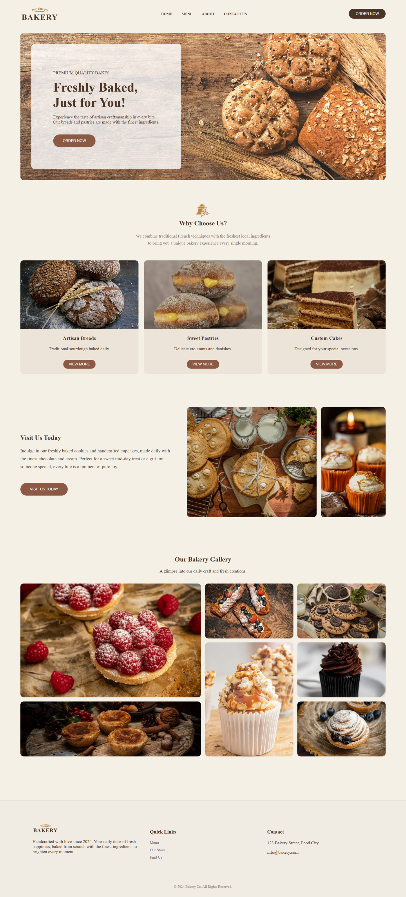
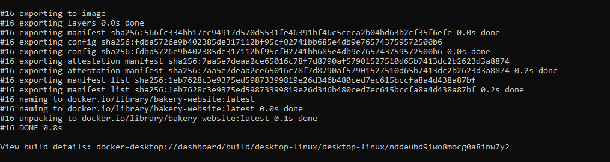
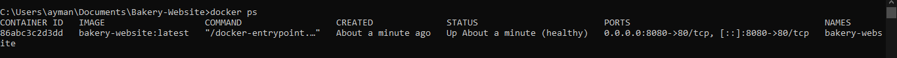
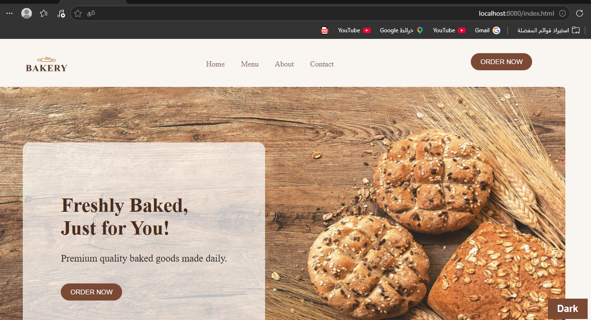
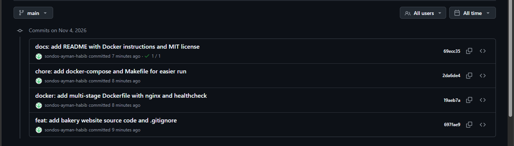

# Bakery-Website

A multi-page bakery website (Home, Menu, About, Contact) served by **Nginx inside Docker**.
It has real interactive features you can test in the browser:

- **Menu filter**: filter products by All / Cake / Bread / Pastry
- **Dark / Light mode** toggle and **back-to-top** button on the home page
- **"Read more"** toggle in the About page
- **Contact form validation** (name, email, subject, message)



## Tech stack

- HTML5, CSS3, vanilla JavaScript
- Nginx (`nginx:alpine`) as the web server
- Docker (multi-stage build) + Docker Compose
- GitHub Actions (CI)

## Run with Docker

Requirements: [Docker Desktop](https://www.docker.com/products/docker-desktop/) installed and running.

```bash
# 1. Clone the repository
git clone https://github.com/sondos-ayman-habib/Bakery-Website.git
cd Bakery-Website

# 2. Build the image
docker build -t bakery-website .

# 3. Run the container
docker run -d --name bakery-website -p 8080:80 bakery-website
```

Open **http://localhost:8080** in your browser.

### Or with Docker Compose

```bash
docker compose up -d --build
```

### Or with Make

```bash
make build
make run
```

## Stop and clean up

```bash
docker stop bakery-website
docker rm bakery-website
docker rmi bakery-website        # optional: remove the image
```

With Compose: `docker compose down`  |  With Make: `make clean`

## Configuration

| Item | Value |
|------|-------|
| Container port | `80` |
| Host port (default) | `8080` (change with `-p <port>:80`) |
| Health endpoint | `GET /health` returns `ok` |
| Environment variables | None required |

## How to test it

1. Open `http://localhost:8080` and check the home page loads with images.
2. Click **Menu**, then press **Cake / Bread / pastry** and confirm products are filtered.
3. Press the **Dark** button (bottom-right) to switch themes.
4. Open **Contact**, submit an empty form and confirm the validation errors appear.
5. Check health: `curl http://localhost:8080/health` should print `ok`.
6. Check container status: `docker ps` should show `(healthy)`.

## Project structure

```
Bakery-Website/
├─ src/                 # website source (HTML, CSS, JS, images)
├─ docs/
│  ├─ screenshots/
│  └─ notes.md
├─ .github/workflows/   # CI: build image + smoke test
├─ Dockerfile           # multi-stage build
├─ nginx.conf
├─ docker-compose.yml
├─ Makefile
└─ README.md
```

## Attribution

This is an original student project. Team and gallery photos are stock images
used for educational purposes only (see `docs/notes.md`).

## License

MIT, see [LICENSE](LICENSE).
    
## Screenshots

### 1. Docker build success


### 2. Container running (healthy)


### 3. Project working in the browser


### 4. GitHub commits history



